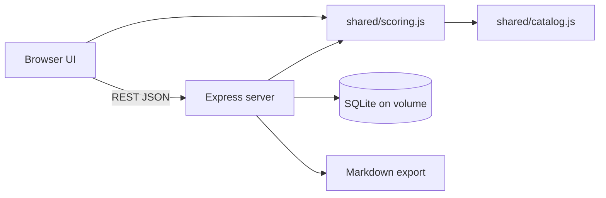

# Requirements

### Overview & Goals
Turn the Pflegegrad calculator into a private, Dockerized case workbench for an objection (Widerspruch) against an MD assessment. You record the Medizinischer Dienst (MD) rating for every NBA criterion next to your own rating, see both live Pflegegrad results, and write a German justification for each deviation. Work is saved automatically and can be revisited over weeks. The tool exports all justifications as Markdown. You write the letter yourself.

### Scope
**In scope**
- Per-criterion entry of the MD rating and your own rating (about 65 criteria, 6 scored modules).
- Official scoring per Anlage 1 and 2 zu § 15 SGB XI, replacing the current simplified tables.
- Live results for MD, own and the difference, so you can see whether an objection can change the Pflegegrad.
- Justification text per deviating criterion, with a status (open / in progress / done).
- Working notes per criterion (e.g. questions for a nurse, interview results) that are not exported.
- Local Docker deployment with persistent storage, and Markdown export.

**Out of scope**
- Generating the objection letter, PDF/DOCX export, multi-user login, cloud hosting.
- Modules 7 and 8 (no points, so they cannot change the Pflegegrad).
- Preserving the old PWA / offline / teaching purpose.

### User Stories
- As a relative, I enter the MD's rating per criterion so I can see exactly where it comes from.
- As a relative, I enter my own rating and immediately see whether the Pflegegrad would change.
- As a relative, I must justify each criterion where I differ from the MD, and the tool shows which are still missing.
- As a relative, I come back days later, see what is still open, and add notes after talking to nurses.
- As a relative, I export the justifications in German Markdown to build the letter.

### Functional Requirements
- **Case overview:** MD vs own module points, weighted points and Pflegegrad side by side. It also shows the points still missing to the next Pflegegrad, and the deviation list with status. The overview shows a warning if the MD total does not match the points printed in the report.
- **Module pages:** each criterion row shows the official wording, an MD rating, your own rating, a deviation highlight, a justification field, and a notes log. The justification field is mandatory in the UI and export only when the ratings differ. Module 3 and Module 5 use their own input types, because their scales differ from the 0-3 scale.
- **Module 2 vs 3 rule:** the higher weighted value counts. This is visible in the result, and the non-counting module is struck through.
- **Autosave:** every change is stored on the server within a second, with a visible "saved" indicator. No manual save button.
- **Export:** `GET /api/export.md` returns a German Markdown file. It has a summary table (MD vs own, Pflegegrad) and one section per module. Each deviating criterion lists the criterion, the MD rating, your rating and the justification. Missing justifications are flagged at the top. Working notes are not included.
- **Language:** the UI, the criterion texts and the export are German. The justifications are whatever German you write.

### Non-Functional Requirements
- Health data stays local: the container listens on `127.0.0.1` only and has no external requests (no CDN).
- Data survives container restarts and rebuilds (Docker volume).
- Scoring is a single code path, so the screen and the export never disagree.

# Technical Design

### Current Implementation
- The app is a single `index.html` (about 1300 lines). It has inline CSS, a `MODULES` object (criteria, scales, `lookup()` per module), `selections` stored in `localStorage` (`pg-selections`), and `updateResult()` for the live score. It also has `sw.js`, `manifest.json` and `icons/` for the PWA.
- **The scoring does not match the law.** I compared the code with Anlage 2 (gesetze-im-internet.de):
  - Module 1: the code gives 2.5 points for sums up to 3 (0-1 gives 0 in the law), 5 up to 6, 7.5 up to 9. The official bands are 0-1 / 2-3 / 4-5 / 6-9 / 10-15.
  - Module 3: the code uses a 0-3 frequency scale with a maximum of 39. The law has a maximum of 65 and bands 0 / 1-2 / 3-4 / 5-6 / 7-65.
  - Module 5: the code sums to 48. The law has a maximum of 15 and bands 0 / 1 / 2-3 / 4-5 / 6-15. The README itself says it is a "simplified teaching form".
  - Modules 2, 4 and 6 have correct bands. Module 4 has correct factors for 4.8 to 4.10 and 4.13.
- The weights (10/15/40/20/15 %) and the Pflegegrad thresholds (12.5 / 27 / 47.5 / 70 / 90) are the same as the law. The criterion wording needs to be checked against Anlage 1.

### Key Decisions
- **Node.js 22 + Express + SQLite (`better-sqlite3`) in one container.** The container serves the static UI and a small JSON API. The SQLite file lives on a mounted volume. This is the structure you chose.
- **Shared ESM scoring module** `shared/scoring.js`. The browser imports it as a static file, and the server imports it for the export, so the numbers always agree. There is no build step, and the UI stays vanilla JS like the original.
- **Ratings store raw inputs, not points.** Points are always computed, so fixing a scoring bug never needs a data migration.
- **Autosave per field (debounced PUT).** This suits a week-long process and avoids lost text.
- **Official scoring from Anlage 1 and 2.** The criterion catalog (`shared/catalog.js`) is rebuilt from the law text, reusing the existing wording where it matches. The module-level results are checked against the points printed in your mother's MD report.

### Architecture Diagram


### Data Models / Contracts
SQLite tables (created on startup in `server/db.js`):
```sql
ratings(criterion_id TEXT, source TEXT CHECK(source IN ('md','own')),
        value TEXT NOT NULL,           -- JSON: rating, or frequency inputs for module 3/5
        updated_at TEXT, PRIMARY KEY(criterion_id, source));
justifications(criterion_id TEXT PRIMARY KEY, text TEXT, status TEXT DEFAULT 'open', updated_at TEXT);
notes(id INTEGER PRIMARY KEY, criterion_id TEXT NULL, text TEXT, created_at TEXT);  -- NULL = general note
meta(key TEXT PRIMARY KEY, value TEXT);  -- e.g. MD-printed module totals for cross-check
```
API:
```
GET    /api/case                         -> {ratings, justifications, notes, meta}
PUT    /api/ratings/:source/:criterionId -> {value}
PUT    /api/justifications/:criterionId  -> {text, status}
POST   /api/notes   DELETE /api/notes/:id
PUT    /api/meta/:key
GET    /api/export.md
```
Scoring API in `shared/scoring.js`:
```js
scoreModule(moduleId, ratings) -> {rawPoints, weightedPoints, answered, total}
scoreCase(ratings) -> {modules, counted23, totalWeighted, pflegegrad}
deviations(mdRatings, ownRatings) -> [{criterionId, md, own}]
```

### File Structure
```
shared/catalog.js      # criteria, scales, point tables per Anlage 1
shared/scoring.js      # official scoring per Anlage 2
server/index.js        # Express app, static hosting
server/db.js           # SQLite schema + queries
server/export.js       # Markdown generator
public/index.html, app.js, styles.css   # reworked from the old index.html
test/scoring.test.js, test/export.test.js, test/api.test.js
Dockerfile, docker-compose.yml, package.json, README.md (rewritten)
```
Removed: `sw.js`, `manifest.json`, `icons/`, `og-image.png` and `icon.svg` (PWA and offline caching would serve stale code). LICENSE files are kept.

### Risks
- **Module 5 and Module 3 rules are the most intricate.** Module 5 depends on how often a measure occurs per day, week or month. Mitigation: implement exactly from Anlage 1, add unit tests with worked examples, and cross-check against the module points in the real MD report.
- **Module 4 special rules** (the tube feeding criterion's effect on other criteria, the "entfällt" cases for incontinence). Mitigation: take them from Anlage 1 and cover them with tests.
- **Data loss.** The SQLite file is on a bind-mounted `./data` folder, so it can be backed up by copying it. SQLite runs in WAL mode.
- **Legal text accuracy.** The criterion names and scale descriptions are checked against Anlage 1 during implementation. The justifications themselves are your responsibility, because they go to a public authority.

# Testing

### Validation Approach
Unit tests with `node:test` for scoring and export, API tests against a temporary SQLite file, and a Docker smoke test.

### Key Scenarios
- Boundary tests for each module band in Anlage 2 (e.g. Module 1 sums 1/2/3/4/5/6/9/10, Module 3 sums 0/1/2/3/4/5/6/7, Module 5 sums 0/1/2/3/4/5/6).
- Module 2 vs 3: the higher weighted value counts.
- Pflegegrad thresholds at 12.5, 27, 47.5, 70 and 90 total weighted points.
- A full worked case (module points entered by hand) reproduces the expected Pflegegrad.
- Export of a case with deviations produces the expected German Markdown, and open (unjustified) deviations are listed.
- Data written through the API survives a restart of the Docker container (`docker compose down` and `up`).

### Edge Cases
- Unrated criteria (partial case): the score is shown as partial, and no crash.
- Identical MD and own rating: no justification required, and any existing text is kept but not exported.
- Empty database: the first start creates the schema.
- Umlauts and long multi-paragraph justifications are saved and exported intact (UTF-8).

### Test Changes
All tests are new. The old single-file app had none.

# Delivery Steps

### ✓ Step 1: Scaffold Node project and rebuild the official criteria catalog and scoring
A tested shared scoring module reproduces Anlage 1 and 2 zu § 15 SGB XI.

- Create `package.json` (ESM, Express, better-sqlite3) and the `shared/`, `server/`, `public/` and `test/` folders.
- Build `shared/catalog.js` from Anlage 1 (gesetze-im-internet.de), reusing criterion wording from the old `index.html` where it matches. Include the correct scales and point tables for Modules 1-6, including the Module 3 values (0/1/3/5), the Module 4 factors and special rules, and the Module 5 frequency-based points.
- Implement `shared/scoring.js` with `scoreModule`, `scoreCase` and `deviations`, using the Anlage 2 bands and weights and the Module 2/3 higher-value rule.
- Add `test/scoring.test.js` with boundary tests for every band and the Pflegegrad thresholds.

### ✓ Step 2: Add SQLite persistence and the REST API
The server stores ratings, justifications and notes in SQLite and serves them over a JSON API.

- Implement `server/db.js` (schema, WAL mode, data path from `DATA_DIR`) and `server/index.js` (Express, static hosting of `public/` and `shared/`).
- Add the endpoints for ratings (`md` and `own`), justifications with status, notes, and meta (MD-printed module totals).
- Validate input against the catalog (known criterion ids, allowed values).
- Add `test/api.test.js` against a temp database.

### ✓ Step 3: Build the comparison UI with live scores and autosave
You can enter MD and own ratings per criterion and see both live results in the browser.

- Rework the old `index.html` into `public/index.html`, `app.js` and `styles.css` (German, vanilla JS, dark/light theme kept).
- Add an overview showing MD vs own module points, Pflegegrad, points missing to the next level, and the MD-total cross-check warning.
- Add module pages with the criterion rows: MD rating, own rating, deviation highlight, and the Module 3 / Module 5 input types.
- Wire everything to the API with debounced autosave and a "saved" indicator, and import `shared/scoring.js` for the live calculation.
- Remove the PWA files (`sw.js`, `manifest.json`, `icons/`).

### ✓ Step 4: Add justification workflow, notes log and Markdown export
Each deviation can be justified, tracked and exported as German Markdown.

- Show a justification textarea with a status (open / in progress / done) on every deviating criterion, and a notes log with timestamps per criterion plus general notes.
- Add a deviation worklist on the overview with filters by status and module, and a count of missing justifications.
- Implement `server/export.js` and `GET /api/export.md` with a summary table, a section per module, a flag list for missing justifications, and notes excluded.
- Add a download button and `test/export.test.js`.

### ✓ Step 5: Dockerize with persistent volume and rewrite the README
`docker compose up` starts the tool on localhost with data that survives restarts.

- Add a `Dockerfile` (node:22-slim, production install) and a `docker-compose.yml` with the `./data:/data` volume, `DATA_DIR=/data`, and the port bound to `127.0.0.1:3000`.
- Verify the persistence by writing data, running `docker compose down` and `up`, and checking that the data is still there.
- Rewrite `README.md` (purpose, how to run, backup by copying `data/`, how scoring is verified, and the disclaimer that this is a helper and not legal advice).).